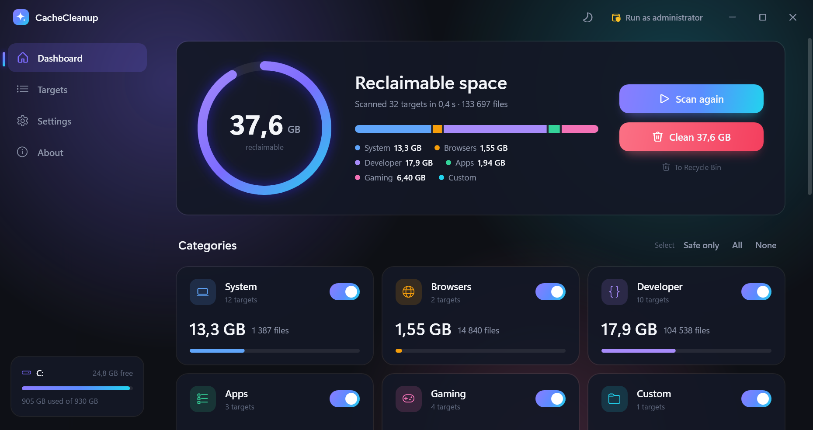
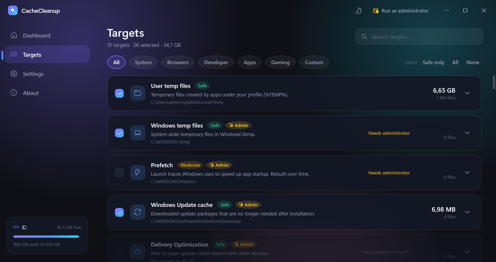
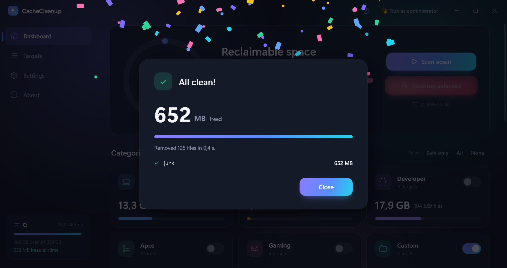
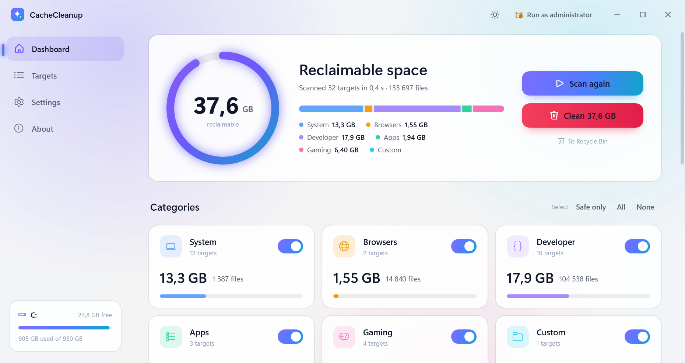
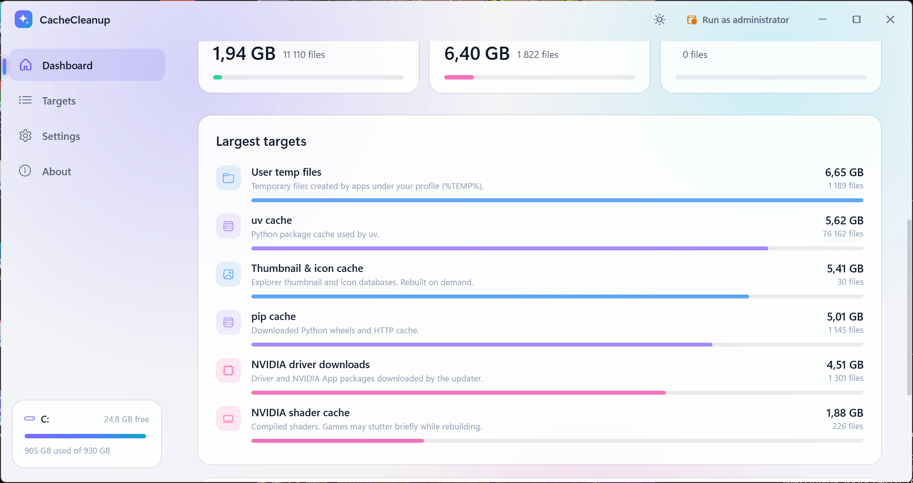
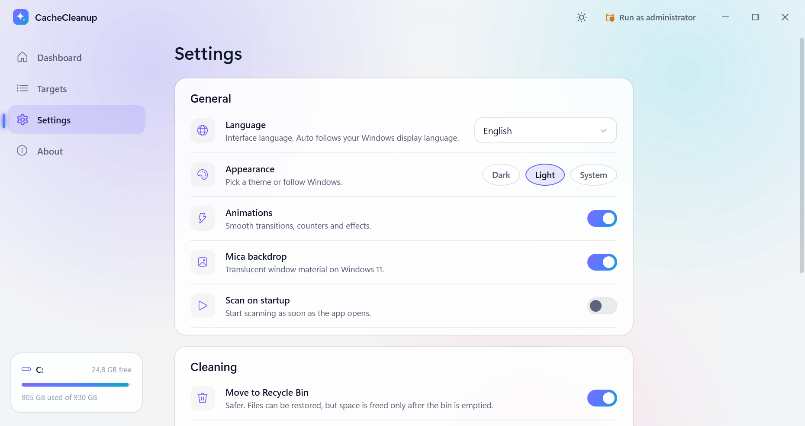
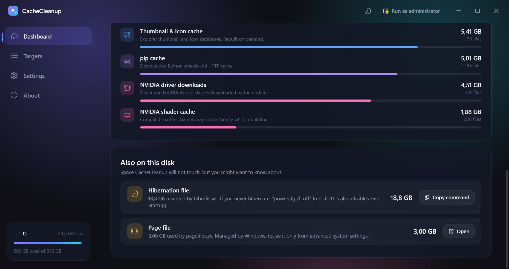

<p align="center">
  
</p>

<h1 align="center">CacheCleanup</h1>

<p align="center">
  <b>Reclaim your disk. Beautifully.</b><br>
  A fast, native Windows cleaner for caches, temp files and leftovers — with a UI you actually want to open.
</p>

<p align="center">
  <a href="https://github.com/Kreal-exe/CacheCleanup/actions/workflows/build.yml"></a>
  <a href="https://github.com/Kreal-exe/CacheCleanup/releases"></a>
  
  
  
  <a href="LICENSE"></a>
</p>

<p align="center">
  
</p>

---

## Why

Windows Settings says *"Installed apps: 107 GB"* and leaves you guessing. Most of that is not apps — it is browser caches, package-manager caches, shader caches, old installers, firmware downloads and other junk that regenerates itself the moment you need it. CacheCleanup knows where that junk lives, measures it in under a second, and lets you throw it out with one click — safely.

## Highlights

- **56 built-in targets** across System, Browsers, Developer tools, Apps and Gaming — from `%TEMP%` and thumbnail caches to pip / npm / NuGet / Cargo, Chrome / Edge / Firefox, Discord / Telegram / Spotify, NVIDIA / AMD shader caches, Steam / Epic / GOG launchers, iTunes firmware leftovers and more.
- **Fast, parallel scanning.** 130 000+ files are measured in well under a second; the dashboard counts up live while it runs.
- **Risk-aware.** Every target is tagged *Safe*, *Moderate* or *Careful*, with a one-line explanation of what deleting it costs you. *Safe only* selects the no-brainers.
- **Safe by design.** Files go to the Recycle Bin by default (permanent deletion is a switch). Only files underneath scanned locations are ever touched; drive roots, Windows, Program Files and your personal folders are hard-blocked. Recent temp files can be skipped automatically.
- **Insights.** Things the cleaner will not touch but you should know about: the hibernation file, page file, `Windows.old`, a full Recycle Bin — with the exact command or settings page to deal with them.
- **Custom folders.** Add your own cache directories; they are scanned and cleaned like any other target.
- **Administrator aware.** System locations that need elevation are marked; one click restarts the app elevated.
- **A UI that moves.** Mica backdrop on Windows 11, dark and light themes, animated counters, a live breakdown bar, staggered card entrances, smooth expanders, a sliding navigation indicator, confetti when you are done.
- **9 languages**, auto-detected from Windows and switchable live: English, Русский, Українська, Deutsch, Français, Español, Polski, 简体中文, 日本語.

## Screenshots

| Targets | Cleaning |
|:--:|:--:|
|  |  |

| Light theme | Largest targets |
|:--:|:--:|
|  |  |

| Settings | Insights |
|:--:|:--:|
|  |  |

## Download

Grab the latest build from the [Releases](https://github.com/Kreal-exe/CacheCleanup/releases) page:

- `CacheCleanup-win-x64.zip` — small, needs the [.NET 10 Desktop Runtime](https://dotnet.microsoft.com/download/dotnet/10.0).
- `CacheCleanup-win-x64-selfcontained.zip` — larger, runs anywhere.

Unzip, run `CacheCleanup.exe`. No installer, no services, no telemetry. Settings live in `%AppData%\CacheCleanup\settings.json`.

Requires Windows 10 1903 or later. Mica backdrop needs Windows 11 22H2+; everything else works on Windows 10.

## What it cleans

<details>
<summary><b>System</b> (13)</summary>

| Target | Location | Risk |
|---|---|---|
| User temp files | `%TEMP%` | Safe |
| Windows temp files | `%WINDIR%\Temp` | Safe · admin |
| Prefetch | `%WINDIR%\Prefetch\*.pf` | Moderate · admin · off by default |
| Windows Update cache | `SoftwareDistribution\Download` | Safe · admin |
| Delivery Optimization | DO cache | Safe · admin |
| Thumbnail & icon cache | `Explorer\thumbcache_*.db`, `iconcache_*.db` | Safe |
| Windows web cache | `INetCache` | Safe |
| Crash dumps | `%LOCALAPPDATA%\CrashDumps` | Safe |
| Error reports | WER queue and archive | Safe |
| Windows logs | CBS, DISM, Windows Update logs | Safe · admin |
| System memory dumps | `Minidump`, `LiveKernelReports` | Safe · admin |
| DirectX shader cache | `D3DSCache` | Safe |
| Recycle Bin | — | off by default |
</details>

<details>
<summary><b>Browsers</b> (6)</summary>

Chrome, Edge, Brave, Vivaldi, Opera / Opera GX (all profiles: HTTP cache, code cache, GPU cache, service-worker cache, shader caches) and Firefox (cache2, startup cache, shader cache).
</details>

<details>
<summary><b>Developer</b> (19)</summary>

pip, uv, npm, Yarn, pnpm, NuGet HTTP cache, NuGet packages (off by default), Gradle, Maven (off), Cargo, Go build cache, VS Code caches, JetBrains IDE caches, Visual Studio caches, Playwright browsers (off), Hugging Face hub (off), Android build cache, Conda packages, Unreal derived data.
</details>

<details>
<summary><b>Apps</b> (8)</summary>

Discord, Telegram Desktop, Spotify, Slack, Microsoft Teams, iTunes device firmware, Adobe media cache, leftover Squirrel/Electron updaters.
</details>

<details>
<summary><b>Gaming</b> (10)</summary>

NVIDIA shader cache, NVIDIA driver downloads, AMD shader cache, Intel shader cache, Steam caches, Epic Games Launcher, GOG Galaxy, Ubisoft Connect, Battle.net, EA app.
</details>

Targets that do not exist on your PC are shown dimmed and skipped. The full list with every path lives in [`TargetCatalog.cs`](src/CacheCleanup/Core/TargetCatalog.cs) — adding one is a ten-line change.

## Safety model

1. **Scanned roots only.** The cleaner receives the exact file list the scanner produced and refuses anything that is not strictly underneath one of the resolved roots ([`PathGuard`](src/CacheCleanup/Core/PathGuard.cs)).
2. **Protected locations.** Drive roots, `Windows`, `System32`, `Program Files`, `ProgramData`, `AppData`, your profile, Documents, Pictures, Downloads, Desktop and OneDrive can never become a root — not even as a custom folder.
3. **Recycle Bin first.** Deletion goes through the shell with undo enabled; the permanent mode is opt-in.
4. **Locked files are skipped**, never forced. The summary tells you how many were in use.
5. **No overlap.** A unit test guarantees no two targets ever resolve to nested roots, so nothing is counted or deleted twice.
6. **Reparse points are never followed**, so OneDrive placeholders and junctions are left alone.

## Build from source

PowerShell in the repository root, with the [.NET 10 SDK](https://dot.net):

```powershell
.\build.ps1         # → CacheCleanup.exe on the Desktop and opens it (one self-contained file)
.\build.ps1 -Test   # run the xunit suite first
.\build.ps1 -Zip    # also write dist\CacheCleanup-win-x64.zip
$env:INSTALL_DIR = "D:\Apps\CacheCleanup"; .\build.ps1   # install somewhere else
```

The script is one `dotnet publish`. It builds in a temporary folder and puts the exe straight on the Desktop, leaving
nothing inside the project. No other dependencies beyond `CommunityToolkit.Mvvm`.

Handy flags: `--scan` starts scanning immediately, `--page settings` opens on a given page. `tools/capture.ps1` produces the screenshots in this README.

## Project layout

```
src/CacheCleanup
├─ Core/           scan & clean engines, target catalog, path guard, shell interop
├─ Controls/       animation primitives (Counter, Entrance, Smooth, Arc, SegmentBar, Collapsible, PageHost …)
├─ Localization/   LocalizationManager + Strings/*.json (one flat dictionary per language)
├─ ViewModels/     MVVM layer (CommunityToolkit.Mvvm)
├─ Views/          MainWindow, Dashboard, Targets, Settings, About, overlays
└─ Themes/         Dark.xaml, Light.xaml, Styles.xaml (every control template lives here)
tests/CacheCleanup.Tests   xunit: formatter, path guard, resolver, catalog invariants, localization parity, scan/clean behaviour
```

## Contributing

Issues and pull requests are welcome. The most useful contributions:

- **New targets** — add an entry to `TargetCatalog.cs` plus `target.<id>.name` / `.desc` in `Strings/en.json` (other languages fall back to English until translated).
- **Translations** — copy `en.json`, translate, keep keys and `{0}` placeholders; the localization tests will tell you if anything is missing.
- **Bug reports** with the target id and the path involved.

## License

[MIT](LICENSE) © 2026 Kreal-exe
